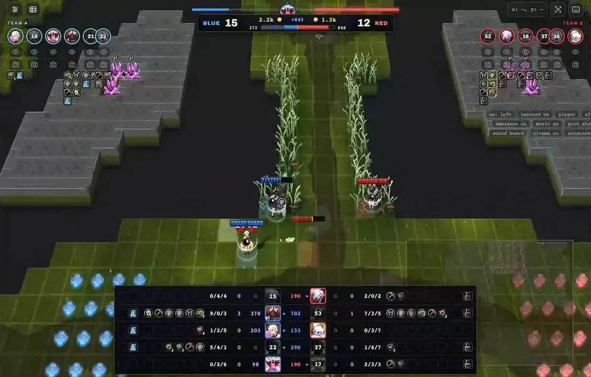
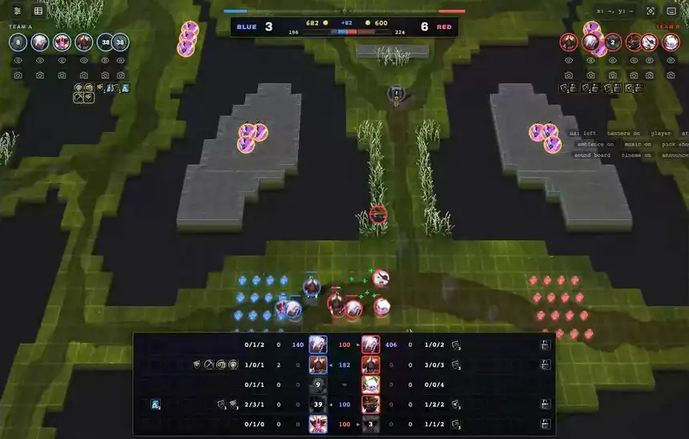
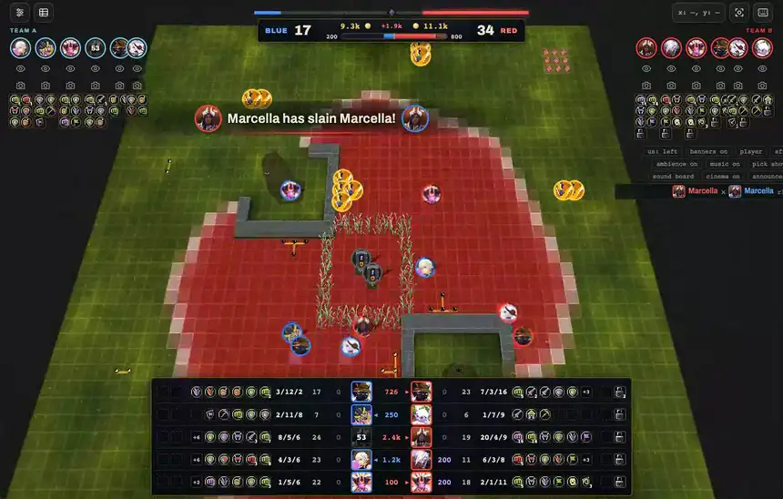
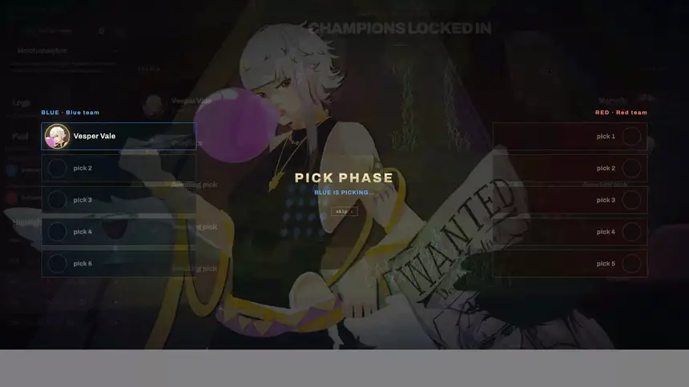
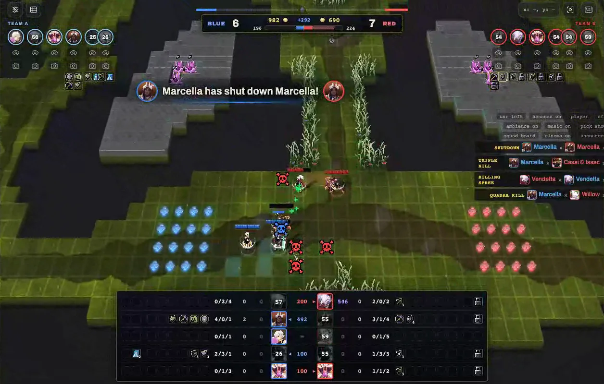

# ultra secret pantheon tech

**League of Legends–style spectating for the Cambridge Battlecode replay viewer.**

Kill banners, a kill feed and the classic announcer, a director camera that follows the fights (with a second
camera when two fights happen at once), League health bars, a scoreboard and a pick-and-ban show.
It's one userscript, and it works in the platform visualiser and in your local `cambc view`.

[**Install**](#install) · [Gallery](#gallery) · [Features](#features) · [Controls](#controls) · [Troubleshooting](#troubleshooting) · [Releases](https://github.com/yufanwang07/ultra-secret-pantheon-tech/releases)

---

## Install

You need a userscript manager, then one click on the script.

### 1. Install a userscript manager

| Browser | Extension |
|---|---|
| Chrome, Brave, Arc, Opera | [Tampermonkey](https://chromewebstore.google.com/detail/tampermonkey/dhdgffkkebhmkfjojejmpbldmpobfkfo) or [Violentmonkey](https://chromewebstore.google.com/detail/violentmonkey/jinjaccalgkegednnccohejagnlnfdag) |
| Edge | [Tampermonkey](https://microsoftedge.microsoft.com/addons/detail/tampermonkey/iikmkjmpaadaobahmlepeloendndfphd) |
| Firefox | [Tampermonkey](https://addons.mozilla.org/firefox/addon/tampermonkey/) or [Violentmonkey](https://addons.mozilla.org/firefox/addon/violentmonkey/) |
| Safari | [Tampermonkey](https://www.tampermonkey.net/?browser=safari) or [Userscripts](https://github.com/quoid/userscripts) (less tested) |

> [!IMPORTANT]
> **Chrome and other Chromium browsers:** extensions can only run userscripts once you allow it.
> Open `chrome://extensions`, click **Details** on Tampermonkey, and turn on **Allow User Scripts**.
> On older Chrome versions (before 138), turn on **Developer mode** (the switch in the top right of `chrome://extensions`) instead.
> If you skip this, the script installs but never runs. Tampermonkey's FAQ covers it [here](https://www.tampermonkey.net/faq.php#Q209).

### 2. Install the script

**[➜ Click here to install ultra secret pantheon tech](https://raw.githubusercontent.com/yufanwang07/ultra-secret-pantheon-tech/main/ultra_secret_pantheon_tech.user.js)**

Your userscript manager opens an install page. Click **Install**. That's it.

You can also grab a pinned version from [Releases](https://github.com/yufanwang07/ultra-secret-pantheon-tech/releases):
download `ultra_secret_pantheon_tech.user.js` and drag it into your browser, or open it from Tampermonkey's
**Utilities → Import from file**.

### 3. Open a replay

- **Platform:** open any match on [2026a.battlecode.co.uk](https://2026a.battlecode.co.uk/game/matches) and click
  watch. The visualiser loads with everything turned on.
- **Locally:** run `cambc view <replay.repl26a>` and open the link it prints
  (`http://127.0.0.1:7026/...`). The script also runs on `localhost` / `127.0.0.1` pages.

Press **play** once. Browsers only let a page play sound after you click something, so the announcer starts with your first click.

### Updating

Updates install themselves. Tampermonkey checks this repo about once a day. To update right away, open the
Tampermonkey dashboard and click **Check for userscript updates**, or just click the install link again.

> [!NOTE]
> If you still have the old **ultra secret pantheon tech · sounds** script, uninstall it. The main script loads its own sounds now.

---

## Gallery

<table>
<tr>
<td width="50%"> <b>Multikills.</b> Shutdowns, sprees, then the big banner: double, triple, quadra, penta, credited to the champion that landed the last hit, with the classic announcer.</td>
<td width="50%"> <b>Aces and the second camera.</b> A double into a triple into an ace. While the main camera holds the fight, a picture-in-picture camera watches the other fight going on at the same time.</td>
</tr>
<tr>
<td width="50%"> <b>From the other side.</b> Enemy multikills get the red banner, and the game ends with League's victory / defeat screen.</td>
<td width="50%"> <b>Pick show.</b> During the draft, each champion's splash art flashes in as it locks, like League's champ select.</td>
</tr>
<tr>
<td colspan="2"> <b>Scoreboard (Tab) and HUD.</b> Champions matched up by role with K/D/A, items and empty slots, gold, gems carried and respawn timers on dead champions. Plus League health bars, the gem tug-of-war bar up top, the kill feed and the toggle bar on the right.</td>
</tr>
</table>

Clips recorded from real ranked games (Mite vs Intercontinental Fish), played back in `cambc view` with the script on.

---

## Features

**Announcer and banners**
- The classic League announcer, with every take of each line from the wiki, shuffled so the same one doesn't repeat back to back: first blood, slain, double → penta, killing sprees, shutdown, executed, ace, victory / defeat.
- League-style kill banners with the champions' own art, plus a small kill feed in the corner.
- Kills go to the champion that landed the last hit. If a monster or tower finished them off, the kill goes to the last enemy champion that hit them within 10 rounds, like League's executes.
- **Player** mode (ally/enemy lines from your team's side) or **Spectator** mode (caster lines).

**Camera**
- **Cinema** mode: the whole match is indexed before you watch, so the camera knows where the fights will be and gets there first. Between fights it follows grouped teams, rotations and recalls.
- **Two cameras:** split screen or picture-in-picture when two fights overlap.
- *cinema fast* cuts quicker for watching at high speed.

**HUD**
- League health bars with segment ticks that scale with max health and zoom.
- Gem bar showing each team's tributed and carried gems.
- **Tab** scoreboard with champions matched by role, item boxes, unspent gold, gems and respawn timers.
- Recall and teleport effects, both zoomed in and zoomed out.

**Sound**
- Kill chimes and multikill melodies, champion attack and ability sounds, recall and teleport channels, gold and shop sounds, map ambience and match music. Sounds only play for things on screen, and get thinned out when a lot is happening at once.
- A **sound board** to preview everything.

---

## Controls

The script adds a small bar of toggles to the top right of the viewer. Every setting is saved.

| Button | What it does |
|---|---|
| `us: left` / `us: right` | Which team counts as yours (picks the ally/enemy lines) |
| `banners on/off` | Kill banners |
| `player` / `spectator` | Announcer voice set |
| `sfx on/off` | Champion and kill sound effects |
| `ambience on/off`, `music on/off` | Map ambience and match music |
| `pick show on/off` | The splash-art draft show |
| `cinema off / on / fast` | Director camera |
| `announcer on/off` | Mute the announcer only |
| `sound board` | Browse and preview every sound |
| **Tab** | Show or hide the scoreboard |

---

## Troubleshooting

<b>Nothing shows up in the viewer</b>

- Chrome: make sure **Allow User Scripts** (or Developer mode) is on for your userscript manager (see [Install](#1-install-a-userscript-manager)).
- Check that the script is enabled in the Tampermonkey dashboard.
- Reload the replay page. The platform visualiser lives in a frame; the script runs inside that frame, so a hard refresh (Ctrl/Cmd+Shift+R) helps after installing.

<b>No sound</b>

Click the viewer once (pressing play counts). Browsers block audio until then. Also check that `announcer on` and `sfx on` are set.

<b>The announcer calls my kills "enemy" kills</b>

Flip the `us:` button to the other side. It's saved per browser.

<b>Two copies of every line</b>

You have the script installed twice, or the old sounds script is still around. Remove the extra copy in the Tampermonkey dashboard.

Found a bug? [Open an issue](https://github.com/yufanwang07/ultra-secret-pantheon-tech/issues).

---

## Legal

ultra secret pantheon tech was created under Riot Games' ["Legal Jibber Jabber" policy](https://www.riotgames.com/en/legal) using
assets owned by Riot Games. Riot Games does not endorse or sponsor this project.

The sound files in `sfx/` belong to Riot Games. Everything here is free and non-commercial: no ads, paywalls,
donations or sponsorships, and no Riot logos or trademarks. Not affiliated with Riot Games or Cambridge Battlecode.
